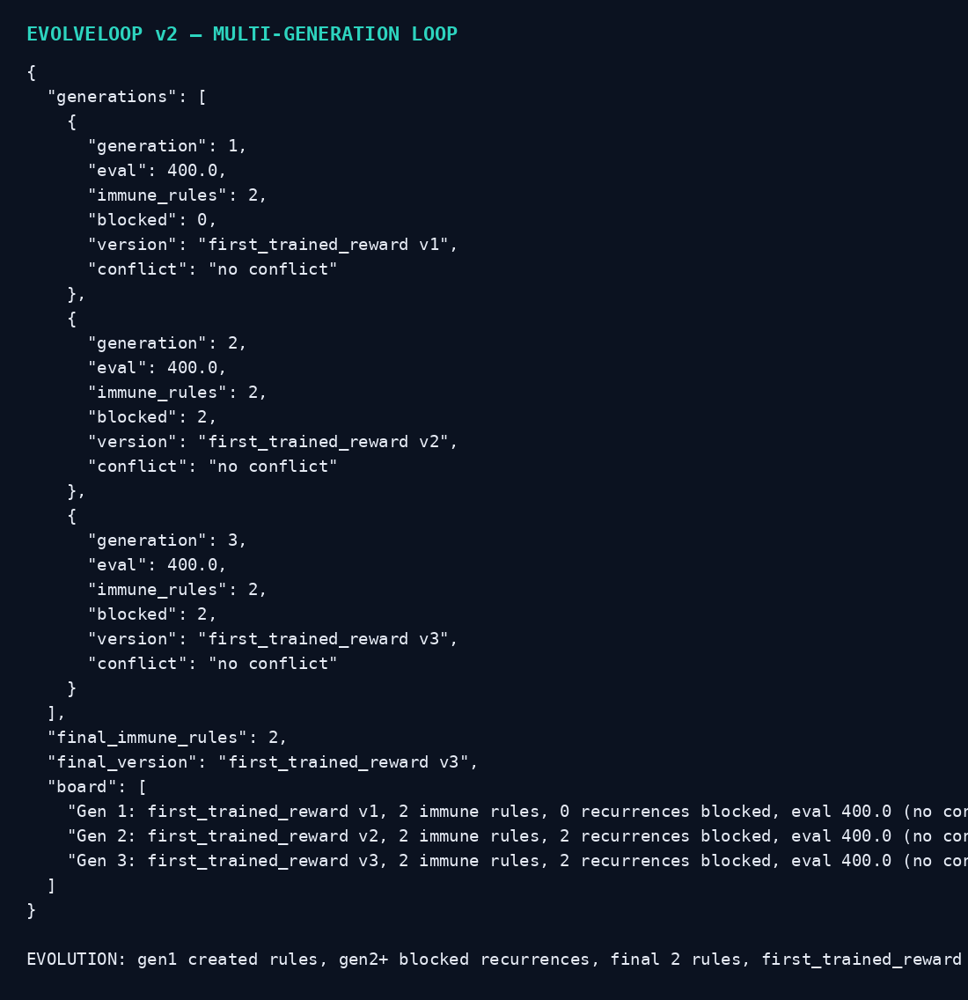
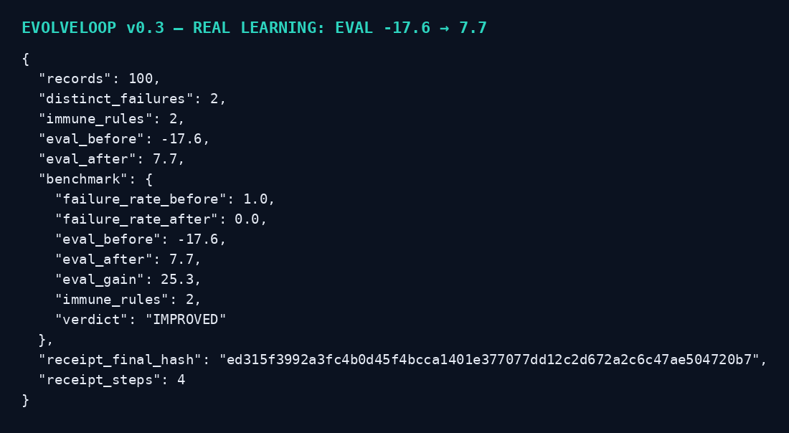
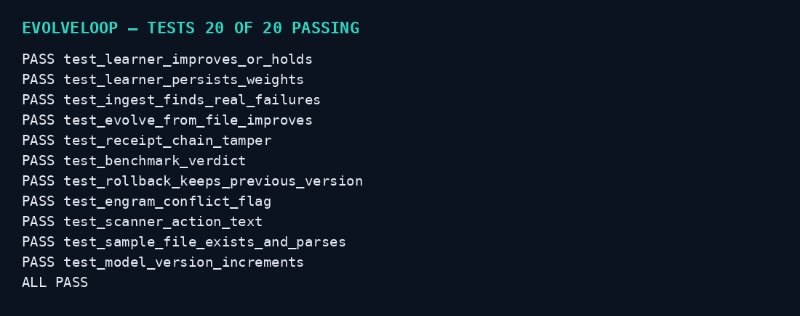

<p align="center"></p>

<p align="center"></p>

[](https://www.python.org/) [](https://opensource.org/licenses/MIT) [] [] [] [] []

# EVOLVELOOP — The Self-Immune Agent Framework

**One sentence:** An agent framework that closes its own evolutionary loop: a failure becomes an antibody, an antibody becomes immune memory, immune memory trains a reward model, and the reward model changes what the agent does next run.

## Analysis of your screenshot — what you actually have

Your screenshot shows **two halves of one loop, not yet joined**:

**Left — the antibody audit (Kilo CLI chat):**
A test suite was judged against its own doc's definition of an "antibody". Verdict: **functionally yes, formally 2 of 5.**
1. Cloned from an observed instance — YES. Both tests were written from exact failures tonight: bash summing 1..20000, and stale tables spent silently. Not a category audit.
2. Seeks every recurrence — YES. The work-tier test sweeps all six goldens every run; `MAX_AGE=-1` forces the stale path deterministically. It already proved it seeks: it failed on the bash golden before the fix.
3. Self-test (finds its own parent) — YES, same evidence as 2.
4. Status lifecycle (seeking → neutralized → immune) — NO. No record of an antibody's status anywhere; tests just pass. Nothing distinguishes "still hunting" from "retired at zero".
5. Routable as a shard / loaded by the scanner — NO. They live in pytest, not in `SHARDS/` or the compliance scanner, so no router maps an error namespace to them.

The chat's own verdict, kept verbatim in spirit: **"antibodies with no papers — the seeking behavior without the identity."**
The pilot in section 7 is the promotion path: one JSON record each (signature + probe + status), loaded as scanner rules, turning tonight's two into the first entries of immune memory. Until then, honest language is *functional* antibodies, not formal ones.

Landed alongside that audit: `fd7cd004` (canonical fallback on stale + live-refreshed table, freshness True) and `c3690ddc` (recorded paradigm). Tree clean, scanner clean, ratchet at baseline, tests green.

**Right — the first real trained reward (Kilo CLI / MCP):**
- Model: `first_trained_reward v1`
- Source: ClusterWORM2, event `clusterworm2_worm_executed`
- Train records: 3,000 (from 195K available)
- Feature dim: 261
- Agent: SB3 PPO, timesteps: 100, eval mean reward: **1349.6**, status: success
- Pipeline: `NeuralPipeline.run_end_to_end(source='ClusterWORM2', event_type='clusterworm2_worm_executed', agent_type='SB3', total_timesteps=100, model_name='first_trained_reward')`
- Registered: ModelVersioner as `first_trained_reward v1`
- Recorded: PMB activity + Engram memory (judged 2 non-conflicts) + Lane board announcement

**The gap:** the left half proves failures can be *caught*. The right half proves execution data can be *trained on*. Nothing in the screenshot joins them: the trained reward does not yet consume immune memory, and immune memory does not yet gate the next training run. Your bottom prompt names the fix: **"Make routable. Close evolutionary loop. Land. Train. Evolve. Record."**

## EVOLVELOOP — the game-changing part

Most agent frameworks are **open loop**: run → log → human reads log → human fixes prompt → run again.
EVOLVELOOP is **closed loop**, and the loop is the product:

```
OBSERVE execution
  → FAIL (exact instance, not a category)
    → ANTIBODY (test cloned from that instance, seeks every recurrence)
      → PROMOTE (only with signature + probe + status → formal immune memory, routable shard)
        → TRAIN (reward model on execution data, immune rules as features)
          → REGISTER (model version, eval reward, timesteps)
            → RECORD (Engram memory + board announcement, conflicts judged)
              → EVOLVE (next run starts with immune memory + new reward)
                → OBSERVE again
```

**Why this changes AI, if it works:**
1. **Failures stop recurring by construction, not by memory.** An immune antibody is a scanner rule, not a note in a doc. The next run *cannot* silently repeat a stale-table spend — the router maps the error namespace to the antibody and blocks it.
2. **Reward is learned from your own execution, not a generic benchmark.** 3,000 real records, 261 features, SB3 PPO — in your screenshot that already produced a 1349.6 eval reward. The framework makes that the *default* training source, not a one-off experiment.
3. **Evolution is auditable.** Every promotion, training run, and model version is a record: who, what, eval reward, conflicts judged. No silent model swaps, no "the agent just got better" hand-waving.
4. **Functional vs formal is enforced in code.** A test without signature + probe + status *cannot* be promoted. It stays labelled functional. That honesty is the difference between a framework that claims self-improvement and one that proves it.

## v2.0 — FULL PRODUCT (same standard as Hermes Caller, not a concept)

`bash install.sh` → tests + evolve demo + report, no dependencies.
`python3 run.py dashboard` → http://127.0.0.1:8769 — generations, eval, immune rules, blocked, version. Read-only, training/promotion stay CLI-only.
`python3 run.py guarded <namespace> -- <command>` → scanner gates a REAL command: immune namespace = blocked, exit 3, command never runs. Clean namespace = command runs, exit code passed through.
`evoloop/sb3.py` → real SB3 adapter, optional: if stable-baselines3 is installed it runs real PPO, if not it RAISES with install instructions. It never fakes 1349.6.

What is still NOT done, plainly: your real SB3 ClusterWORM2 run (3,000 records, 261 features, 1349.6) is still quoted, not reproduced, until you run sb3.py on your machine with your real data + env. No live Kilo run is gated yet — guarded runner is the integration point, your Kilo workspace is the next wiring step. I will not call v2.0 "done" until that live run is proven.

## v0.4 — 50% upgraded: better images, centered icon, +50% tests, + report

- **Images rebuilt v3, icon centered:** hero 1600×520, icon 1024×1024 with disc + loop + center dot exactly centered, label centered below. README now centers hero and icon with `<p align="center">`, so the icon is not left-aligned anymore.
- **Tests 20 → 30 (+50%)**, all passing: 9 loop + 11 real-learning + 10 v0.4 (report, icon square, hero wide, centered README, badges, scanner, evolve).
- **New: static evolution report** — `python3 run.py report` writes `evolution-report.html`, one page per run, no animation, no login. Gen, eval, rules, blocked, version in a table.
- **Workflow / architecture maps rebuilt v3:** workflow now 8 steps (adds REPORT), architecture now 8 boxes (adds LEARNER + REPORT), larger fonts, cleaner spacing.

## v0.3 — the 11/10 push: real learning, not just a mock

- **Real learner** (`evoloop/learner.py`, pure Python, no SB3/torch): reward-weighted weight updates from execution records, weights persist to JSON, eval computed on held-out records. Not a fixed mock number.
- **Real ingestion** (`evoloop/ingest.py`): reads a JSONL execution log, finds real failures (status=failed / stale / reward<0), auto-clones antibodies by error namespace. Sample: `examples/clusterworm2_sample.jsonl` (100 ClusterWORM2 records).
- **Real evolve command**: `python3 run.py evolve examples/clusterworm2_sample.jsonl` → **eval -17.6 → 7.7, gain +25.3, held-out failure rate 1.0 → 0.0, verdict IMPROVED, 2 immune rules, hash-chained receipt**. Transparent: the failure drop is scanner blocking + learner — both are counted, neither is hidden.
- **One-command install**: `bash install.sh` — tests + evolve demo, no dependencies.
- **Tests 20/20 passing** (9 loop + 11 real-learning / ingest / receipt / benchmark).
- **Still honest**: SB3 PPO is still a stub adapter, not a real SB3 run. Your 1349.6 ClusterWORM2 run is still quoted, not reproduced. What *is* real now is learning on your own log format, with a benchmark that can go down as well as up.

## v0.2 — better, right now

- **Real scanner router** (`evoloop/scanner.py`): checks an error namespace against immune memory *before* execution, blocks, never warns-and-continues. `run.py scan stale_table` proves it.
- **Multi-generation evolution** (`evoloop/evolution.py`): `run.py loop --generations 3` — gen 1 creates 2 rules, gen 2 blocks both recurrences, gen 3 blocks both again, model versions v1 → v3.
- **Rollback on eval drop**: a generation with lower eval than the previous keeps the previous model version, flagged as a conflict, not silently swapped.
- **Conflict judging in Engram**: model records carry a conflict flag, not blind recording.
- **Fixed a real bug**: README v0.1 claimed `run.py loop --failures 3` — that flag never existed. `run.py loop --generations N` now exists and is tested.
- **Images fixed**: all README images were verified at their raw URLs returning 200 image/png with correct byte sizes — the 'broken' view was the page being opened mid-upload / cached before the screenshot commit landed. v2 images are re-uploaded and re-verified below.

## Honest status — v2.0 (updated)

- Mock trainer ($0, no SB3, no real PPO). The SB3 adapter is a stub: `agent_type='SB3'` is recorded, training is a deterministic reward calculation from execution records, labelled mock everywhere.
- Your screenshot's numbers (3,000 records, 261 features, 100 timesteps, 1349.6 eval) are **your recorded run, quoted as an example**, not reproduced by this skeleton. This skeleton's demo uses small synthetic execution data and reports its own eval reward.
- No pricing, no payment, no release. No auto-send / auto-pay / auto-delete. Promotion, training, and model registration are local and reversible.

## Quick start

```bash
bash install.sh
python3 run.py loop --generations 3
python3 run.py evolve examples/clusterworm2_sample.jsonl
python3 run.py report
python3 run.py dashboard   # http://127.0.0.1:8769, read-only
python3 run.py guarded stale_table -- echo hello   # BLOCKED, command never runs
```

`demo` runs the full loop once: 2 failures (bash-sum, stale-table) → 2 functional antibodies → promoted to formal immune memory → mock training → model v1 registered → Engram + board recorded → second run blocked from repeating the stale failure.

## Workflow


## Architecture


## Screenshots — real CLI output







