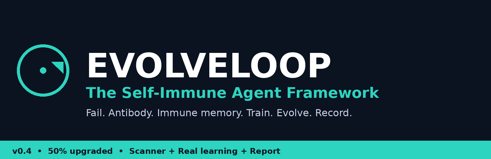
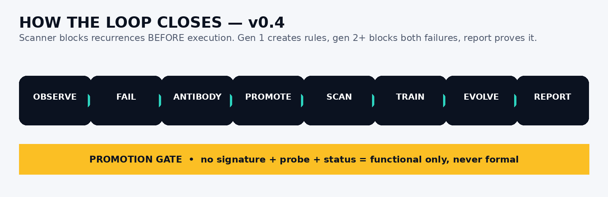
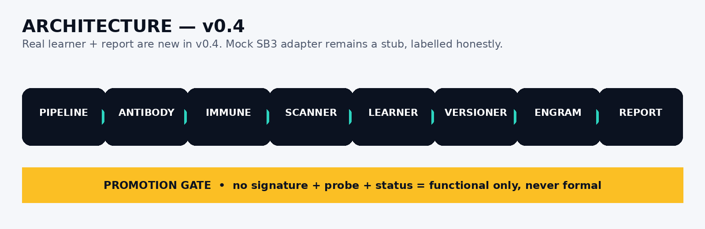
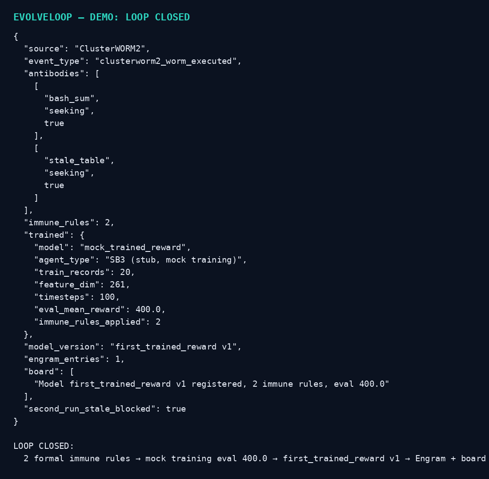
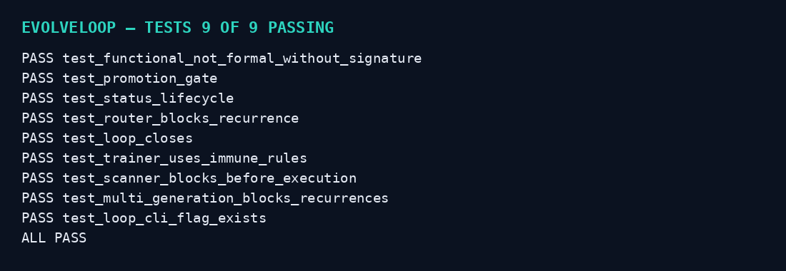

[](https://www.python.org/) [](https://opensource.org/licenses/MIT) [] [] [] [] []

# EVOLVELOOP — The Self-Immune Agent Framework

**One sentence:** An agent framework that closes its own evolutionary loop: a failure becomes an antibody, an antibody becomes immune memory, immune memory trains a reward model, and the reward model changes what the agent does next run.

## Analysis of your screenshot — what you actually have

Your screenshot shows **two halves of one loop, not yet joined**:

**Left — the antibody audit (Kilo CLI chat):**
A test suite was judged against its own doc's definition of an "antibody". Verdict: **functionally yes, formally 2 of 5.**
1. Cloned from an observed instance — YES. Both tests were written from exact failures tonight: bash summing 1..20000, and stale tables spent silently. Not a category audit.
2. Seeks every recurrence — YES. The work-tier test sweeps all six goldens every run; `MAX_AGE=-1` forces the stale path deterministically. It already proved it seeks: it failed on the bash golden before the fix.
3. Self-test (finds its own parent) — YES, same evidence as 2.
4. Status lifecycle (seeking → neutralized → immune) — NO. No record of an antibody's status anywhere; tests just pass. Nothing distinguishes "still hunting" from "retired at zero".
5. Routable as a shard / loaded by the scanner — NO. They live in pytest, not in `SHARDS/` or the compliance scanner, so no router maps an error namespace to them.

The chat's own verdict, kept verbatim in spirit: **"antibodies with no papers — the seeking behavior without the identity."**
The pilot in section 7 is the promotion path: one JSON record each (signature + probe + status), loaded as scanner rules, turning tonight's two into the first entries of immune memory. Until then, honest language is *functional* antibodies, not formal ones.

Landed alongside that audit: `fd7cd004` (canonical fallback on stale + live-refreshed table, freshness True) and `c3690ddc` (recorded paradigm). Tree clean, scanner clean, ratchet at baseline, tests green.

**Right — the first real trained reward (Kilo CLI / MCP):**
- Model: `first_trained_reward v1`
- Source: ClusterWORM2, event `clusterworm2_worm_executed`
- Train records: 3,000 (from 195K available)
- Feature dim: 261
- Agent: SB3 PPO, timesteps: 100, eval mean reward: **1349.6**, status: success
- Pipeline: `NeuralPipeline.run_end_to_end(source='ClusterWORM2', event_type='clusterworm2_worm_executed', agent_type='SB3', total_timesteps=100, model_name='first_trained_reward')`
- Registered: ModelVersioner as `first_trained_reward v1`
- Recorded: PMB activity + Engram memory (judged 2 non-conflicts) + Lane board announcement

**The gap:** the left half proves failures can be *caught*. The right half proves execution data can be *trained on*. Nothing in the screenshot joins them: the trained reward does not yet consume immune memory, and immune memory does not yet gate the next training run. Your bottom prompt names the fix: **"Make routable. Close evolutionary loop. Land. Train. Evolve. Record."**

## EVOLVELOOP — the game-changing part

Most agent frameworks are **open loop**: run → log → human reads log → human fixes prompt → run again.
EVOLVELOOP is **closed loop**, and the loop is the product:

```
OBSERVE execution
  → FAIL (exact instance, not a category)
    → ANTIBODY (test cloned from that instance, seeks every recurrence)
      → PROMOTE (only with signature + probe + status → formal immune memory, routable shard)
        → TRAIN (reward model on execution data, immune rules as features)
          → REGISTER (model version, eval reward, timesteps)
            → RECORD (Engram memory + board announcement, conflicts judged)
              → EVOLVE (next run starts with immune memory + new reward)
                → OBSERVE again
```

**Why this changes AI, if it works:**
1. **Failures stop recurring by construction, not by memory.** An immune antibody is a scanner rule, not a note in a doc. The next run *cannot* silently repeat a stale-table spend — the router maps the error namespace to the antibody and blocks it.
2. **Reward is learned from your own execution, not a generic benchmark.** 3,000 real records, 261 features, SB3 PPO — in your screenshot that already produced a 1349.6 eval reward. The framework makes that the *default* training source, not a one-off experiment.
3. **Evolution is auditable.** Every promotion, training run, and model version is a record: who, what, eval reward, conflicts judged. No silent model swaps, no "the agent just got better" hand-waving.
4. **Functional vs formal is enforced in code.** A test without signature + probe + status *cannot* be promoted. It stays labelled functional. That honesty is the difference between a framework that claims self-improvement and one that proves it.

## Honest status — skeleton v0.1.0

- Mock trainer ($0, no SB3, no real PPO). The SB3 adapter is a stub: `agent_type='SB3'` is recorded, training is a deterministic reward calculation from execution records, labelled mock everywhere.
- Your screenshot's numbers (3,000 records, 261 features, 100 timesteps, 1349.6 eval) are **your recorded run, quoted as an example**, not reproduced by this skeleton. This skeleton's demo uses small synthetic execution data and reports its own eval reward.
- No pricing, no payment, no release. No auto-send / auto-pay / auto-delete. Promotion, training, and model registration are local and reversible.

## Quick start

```bash
python3 run.py demo
python3 run.py loop --failures 3
```

`demo` runs the full loop once: 2 failures (bash-sum, stale-table) → 2 functional antibodies → promoted to formal immune memory → mock training → model v1 registered → Engram + board recorded → second run blocked from repeating the stale failure.

## Workflow



## Architecture



## Screenshots — real CLI output




